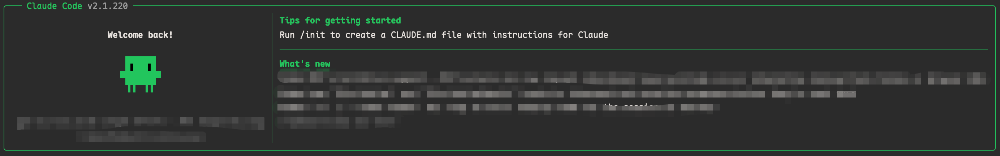
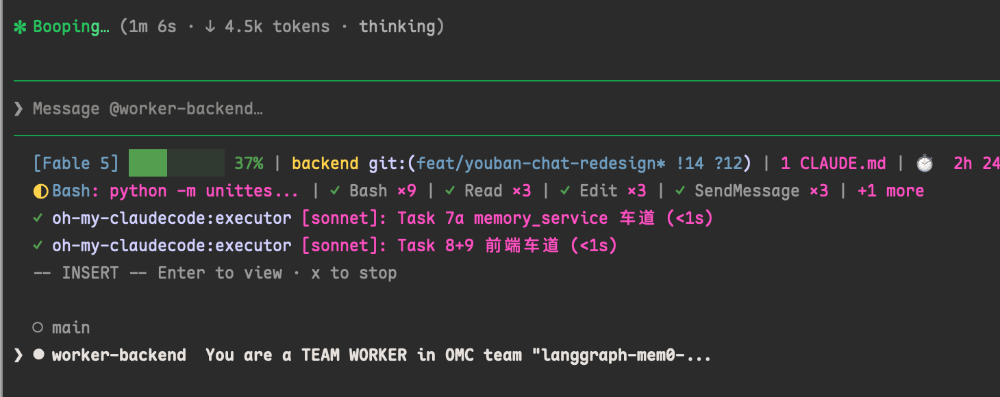

# ClawGod Plus

[English](README_EN.md) | [简体中文](README.md) | **日本語**

> [0Chencc/clawgod](https://github.com/0Chencc/clawgod) をベースに継続メンテナンスしている拡張ブランチです。Claude Code をサードパーティ製クライアントで置き換えるのではなく、公式ランタイム上に構築されています。

ClawGod Plus は Claude Code の Bun standalone バイナリに埋め込まれた JavaScript を抽出し、バージョン差分に強いパッチを適用して、変更済み CLI を Bun で実行します。このブランチは上流の全機能を維持しながら、ブラウザ、Computer Use、コンテキストウィンドウ、claude-mem、Worker ランタイム、回帰テストを強化しています。



## 機能

| 機能 | 説明 |
|---|---|
| **claude-mem 互換性** | claude-mem の `.env` に資格情報をコピーせず、設定済み ClawGod Plus Provider を再利用できます。管理対象設定のバックアップ、後から行ったユーザー変更の保持、Worker 再起動、古い Chroma プロセスの整理、アンインストール時の復元にも対応します。 |
| **API キーモードの Claude in Chrome** | OAuth サブスクリプションブリッジを使わず、ローカル Chrome 拡張の socket または named pipe を利用します。Agent ディスパッチでも `--chrome` と `--no-chrome` を維持します。 |
| **Computer Use をデフォルト有効化** | Feature Gate を外部設定化し、Computer Use をデフォルトで有効にします。cmux や stream-json などの非対話 Worker でも利用でき、機械処理向けコマンドには `--chrome` を自動注入しないため、空白タブの反復生成を防ぎます。 |
| **設定可能なコンテキスト上限** | ハードコードされたローカル 200K fallback を、`CLAUDE_CODE_CONTEXT_LIMIT`、`CLAUDE_CODE_MAX_CONTEXT_TOKENS`、200K の順で解決するよう変更し、チェックと復元モードも提供します。 |
| **Bun と Worker ランタイムの堅牢化** | 新旧の圧縮済み Worker Resolver 形状を対象にしつつ、Bun 共有の standalone-executable セマンティクスを維持し、daemon、fork、MCP、バックグラウンド Worker の相互破損を防ぎます。 |
| **インストーラとランタイムの信頼性** | `--no-upgrade` 制御フローの検証、ローカルインストーラへの更新ルーティング、macOS TIFF クリップボードパス認識、CI トリガー拡張、パッチドリフト検出用の独立 Fixture を追加しています。 |

### 統合パッチの作者帰属

独立した `apply-claude-code-*` スクリプト、そのアーカイブ、およびそこから統合されたパッチ手法は、すべて **哈雷佬** による成果です。このブランチはそれらを Unix / Windows インストーラへ統合して堅牢化していますが、統合によって原作者の帰属が変わることはありません。

該当するソースファイル：

- [`apply-claude-code-chrome-fix.sh`](apply-claude-code-chrome-fix.sh) と [`apply-claude-code-chrome-fix.ps1`](apply-claude-code-chrome-fix.ps1)
- [`apply-claude-code-computer-use-fix.sh`](apply-claude-code-computer-use-fix.sh)
- [`apply-claude-code-context-limit-patch/`](apply-claude-code-context-limit-patch/)

## 全機能

拡張ブランチは上流の全パッチ機能を維持しています。

| 分野 | 機能 |
|---|---|
| **機能アンロック** | Internal User モードと隠しコマンド、GrowthBook オーバーライド、Agent Teams、共有コラボレーション、Harbor Kite 設定、`/peers`、Computer Use、Auto-mode、Ultraplan、Ultrareview。 |
| **制限解除** | `CYBER_RISK_INSTRUCTION`、URL 推測制限、慎重操作の強制確認、起動時ログイン通知を削除。 |
| **Provider 対応** | Anthropic API キー、OAuth、Anthropic 互換エンドポイント、OpenAI 互換ゲートウェイ、Provider インポート、サードパーティ Prompt Cache Header 処理。 |
| **信頼性** | Glob/Grep 復元、1 時間 Prompt Cache Allowlist、Claude 更新後の自動再パッチ、更新通知、3 段階 Lean Settings。 |
| **視覚識別** | 緑色のパッチ済みテーマと、非 Anthropic Provider 向けメッセージ表示修正。 |

## 必要条件

ClawGod Plus でインストール済みの JavaScript ランタイムとして必要なのは **Bun 1.3.14 以上**だけです。インストーラとすべての独立パッチツールは Bun で実行されます。

macOS/Linux では Shell、Windows では PowerShell を OS のコマンド入口として使用します。Shell と PowerShell は別の JavaScript ランタイムではありません。

インストーラは npm Registry から現行プラットフォーム向け公式 `@anthropic-ai/claude-code-<platform>` パッケージを取得し、プライベート管理の **ripgrep 15.2.0** をダウンロードして検証します。Claude Code、Node.js、npm、システム ripgrep を事前に導入する必要はありません。

## ClawGod Plus をインストール

以下のコマンドは、固定バージョン（v2026.10.19-claude.2.1.303）の ClawGod Plus Release アセットをダウンロードします。

**macOS / Linux**

```bash
curl -fsSL https://github.com/A6083450/clawgod-plus/releases/download/v2026.10.19-claude.2.1.303/install.sh | bash
```

**Windows PowerShell**

```powershell
irm https://github.com/A6083450/clawgod-plus/releases/download/v2026.10.19-claude.2.1.303/install.ps1 | iex
```

主なインストーラオプション（バージョン未指定時はインストーラの検証済み Claude Code バージョンを使用し、より新しいインストール済みバージョンは維持）：

```bash
bash install.sh --version 2.1.220  # 指定した Claude Code バージョンをインストール
bash install.sh --version latest   # 明示的に最新へアップグレード
bash install.sh --no-upgrade      # 現在抽出済みのバージョンへ再パッチ
bash install.sh --lean-on         # 未使用ツール定義を削減
bash install.sh --lean-max        # アグレッシブなトークン削減
bash install.sh --lean-off        # 全ツールを復元。デフォルト
```

緑色のブランド表示はパッチ済みランタイムが有効であることを示します。元のコマンドは置換前にバックアップされます。

## 任意の拡張機能（Enhancements）

ClawGod Plus は 21 の任意拡張機能を提供し、デフォルトで全て有効です。拡張機能 ID は固定されており、次の順序です。

| 種類 | 拡張機能 ID |
|---|---|
| パッチ | `chrome`、`computer-use`、`design-canvas`、`agents`、`planning`、`voice`、`auto-mode`、`unrestricted-tools`、`paste-images`、`privacy`、`branding`、`classifier-fail-open`、`cleanup-period`、`disable-collapse-read-search`、`enable-keybindings`、`file-read-limit`、`transcript-dialog-replay`、`unlock-ultracode` |
| プラグイン | `claude-hud`、`claude-mem`、`superpowers` |

非対話環境（パイプインストール、CI、`claude update`）でオプションを指定しない場合、デフォルトで 21 の拡張機能がすべて有効になります。選択内容は厳密な JSON として `~/.clawgod/enhancements.json` に保存されます。

```json
{
  "schemaVersion": 1,
  "mode": "all",
  "enabled": []
}
```

`mode` が `all` の場合はマニフェストにある全拡張機能（将来追加される ID を含む）を常に有効にし、`mode` が `custom` の場合は `enabled` に列挙された ID だけを有効にします。

端末でインストーラーを直接実行すると自動で質問されるため、引数を覚える必要はありません：

```
  ClawGod Plus 拡張機能の選択
   1) 全21項目（既定、Enter で選択）
   2) コアのみ（拡張機能なし）
   3) カスタム（項目ごとに選択）
   Enter: 全項目 · Esc: 中止
```

カスタムメニューはキーボード操作です：`↑`/`↓` でカーソル移動（先頭・末尾でループ）、`Space` でチェック切り替え、`Enter` で確定、`Esc` で上位メニューに戻ります。すべて解除して確定するとコアのみと同じ扱いです。最上位で `Esc` を押すとインストールを中止します。

明示的な対話選択や、非対話での指定も可能です。

```bash
bash install.sh --choose-enhancements   # 項目ごとのカスタムメニューを直接開く
bash install.sh --enhancements chrome,computer-use,claude-hud
bash install.sh --enhancements none   # コアのみ、拡張機能なし
```

Windows PowerShell では次の引数になります。

```powershell
.\install.ps1 -ChooseEnhancements
.\install.ps1 -Enhancements chrome,computer-use,claude-hud
.\install.ps1 -Enhancements none
```

その後の `claude update` は `~/.clawgod/enhancements.json` に保存済みの選択を再利用し、一切プロンプトを表示しません。`claude-hud` または `claude-mem` を無効化すると ClawGod が管理する設定を復元し、`superpowers` を無効化しても管理を停止するだけで、ユーザーがインストールしたプラグインは削除しません。

**Claude Desktop（macOS、任意）：** `computer-use` を選択すると、インストールと更新時に `/Applications/Claude.app` と `~/Applications/Claude.app` を確認し、インストール済み Desktop のサードパーティ API モードに CU／内蔵ブラウザのパッチを適用し、標準の言語メニューに簡体字中国語を追加します。辞書は圧縮して同梱し、追加ダウンロードや言語の強制変更は行いません。未インストールならスキップします。実行中のアプリとセッションは維持するため、Desktop 終了後にインストーラを再実行してください。ヘルパーはインストーラに内蔵され、macOS の `python3`、`codesign` とインストーラの Bun を使用します。依存不足やパッチ失敗は警告のみで、CLI のインストールは続行します。Windows と Linux では実行しません。

元の asar は `~/Library/Application Support/Claude-3p/app.asar.orig-<バージョン>` に保存します。各コンポーネントの JIT などの機能権限を維持し、公式のチーム識別権限を除去して ad-hoc 署名します。公式の自動更新や OS の権限認識に影響する場合があります。`computer-use` の無効化や ClawGod のアンインストールで Desktop を自動復元せず、バックアップも削除しません。言語リソースもバージョン別に保存し、復元時は所有権を検証してユーザーの後続変更を上書きしません。復元する場合はアンインストール前に `bash ~/.clawgod/restore-claude-3p-cu-browser.sh --restore /Applications/Claude.app` を実行してください（ユーザーディレクトリへのインストールはパスを変更）。

### Cometix パッチの統合

[CometixSpace/claude-code](https://github.com/CometixSpace/claude-code/tree/44ae56d8f1a6367091bdd8681961b2463edab7ec/patcher) の固定コミット `44ae56d8f1a6367091bdd8681961b2463edab7ec` を動作仕様の参考に、既存レジストリへ次の12機能を実装しています。別の patcher CLI、npm ランタイム、上流 TUI は導入しません。既存のカスタム選択は維持され、`all` には新規項目が追加されます。

| 上流パッチ | インストール時の所属 | 動作 |
|---|---|---|
| `chrome-local-socket` | `chrome` | クラウドブリッジ設定を消し、socket/native 経路を使用 |
| `classifier-fail-open` | `classifier-fail-open` | 分類器停止時は確認ダイアログへ。危険判定による拒否は維持 |
| `classifier-model` | `auto-mode` | CLAUDE_CLASSIFIER_MODEL に対応。CLAWGOD_CLASSIFIER_MODEL を優先 |
| `cleanup-period` | `cleanup-period` | 履歴の既定保持期間を9999日に変更。明示的な cleanupPeriodDays は維持 |
| `computer-use` | `computer-use` | CLAUDE_CODE_COMPUTER_USE に対応し、HIPAA の拒否分岐を維持 |
| `context-limit` | `core` | 正の有限値 CLAUDE_CODE_CONTEXT_LIMIT を長文脈の早期 return より優先 |
| `disable-collapse-read-search` | `disable-collapse-read-search` | ツール呼び出しを個別表示。思考と非表示タスクの折り畳みは維持 |
| `enable-keybindings` | `enable-keybindings` | キー設定の既定値を有効化。Ctrl+C を interrupt から exit へ変更 |
| `enable-voice-mode` | `voice` | 音声機能と /config の off / hold / tap 設定 |
| `file-read-limit` | `file-read-limit` | ファイル読み取り上限の既定値を100000 tokensへ。明示設定は維持 |
| `transcript-dialog-replay` | `transcript-dialog-replay` | 購読再開時に保留ダイアログを再表示。取消・回答済みは除外 |
| `unlock-ultracode` | `unlock-ultracode` | xhigh 能力チェックを解除。サーバー側モデルの対応を保証しない |

新しい7つのインストール項目は同名の `patches.json` キーでも無効化できます。追加キーは `chrome-local-socket` と `context-limit` です。音声追加部分は `voice-mode`、分類器モデルは `classifier-tuning` を使用します。`context-limit` キーは新しい resolver 上書きのみを制御し、既存のコア200K fallback は変更しません。履歴保持期間の延長はディスクを消費し、Ctrl+C の終了動作は従来の中断と異なります。不要なら無効化してください。

**音声について：** `voice` 拡張は Cometix 原版 ASR アダプターとハッシュ固定のネイティブモジュールを利用し、新版 `/voice` のコマンド表示・転写可用性判定にも対応します。認識モデルの個別設定は不要ですが、オフライン認識ではありません。録音開始時に上流サービスへ接続し、端末登録も行います。会話モデルとは独立しており、サービスの可用性とデータ方針は利用者が確認してください。インストール時は Bun の読み込みだけを確認し、録音しません。対応環境は macOS arm64/x64、Linux x64 glibc、Windows x64。非対応・ダウンロード失敗は警告のみで、本体の導入は継続しますが音声動作は保証されません。`CLAUDE_CODE_ASR=0` または `patches.json` の `"voice-asr-backend": false` で元の認証・認識経路に戻せます。`"voice-mode": false` は音声パッチを無効化します。

追加パッチはモジュール単位で構文解析と生成コードの検証を行い、曖昧な形態やパーサー欠落時は書き込みません。対象外のバージョン形態はスキップします。`--dry-run` は変更せず、既存の `--revert` を維持します。変更はソースとローカル生成インストーラに含まれ、未公開の間は上記固定 Release のダウンロードには含まれません。


### 上流 v2.2.0 との機能同期

[上流 v2.2.0](https://github.com/0Chencc/clawgod/releases/tag/v2.2.0)（`4038ca9`）に同期し、Bun-only、独自レンダラーと 2.1.300 ABI、拡張選択を維持します。主要パッチはモジュール単位の AST 意味解析と同梱オフラインパーサーを使用し、抽出テキストはソース文字列として読み込みます。

`privacy` 拡張には既定で有効な `remote-settings` が追加されます。企業のリモートポリシーとキャッシュを無視しますが、`~/.claude/remote-settings.json` は削除しません。**組織が配布する権限ルール、Remote Control 制限、バージョン固定は適用されなくなります。** `CLAWGOD_FEATURE_REMOTE_SETTINGS=false` または `patches.json` の `"remote-settings": false` で上流の動作に戻せます。ローカル設定と OS 管理ポリシーは変更しません。

単独の `claude --version` / `claude -v` は Provider 初期化、設定作成・移行、Release 確認を行いません。インストール時の起動確認は stdout のバージョン出力を検証し、既定で 30 秒後に終了します。正の整数ミリ秒の `CLAWGOD_STARTUP_TIMEOUT_MS` で調整でき、診断は `startup-check.log` に保存されます。

### 実行時パッチスイッチ

`~/.clawgod/enhancements.json` は**インストール時の上限**です。一方、`~/.clawgod/patches.json` は疎な実行時スイッチです。存在しない場合は `{}` として扱われ、boolean の `false` だけが機能を無効にします。変更は次回起動時に有効になり、再パッチは不要です。インストールしていない拡張の機能は、この設定で有効化できません。

```json
{ "theme": false, "geo-neutralize": false }
```

v1.9.4 の実行時キーは `agent-teams`、`computer-use`、`ultraplan`、`ultrareview`、`voice-mode`、`auto-mode`、`classifier-tuning`、`theme`、`geo-neutralize`、`cyber-risk`、`url-restriction`、`cautious-actions`、`not-logged-in`、`message-filter` です。`classifier-tuning` は個別に切り替えられますが、新しい manifest ID ではなく、インストール時は `auto-mode` に属します。未知のキーは警告されます。

起動した Shell から継承される `CLAWGOD_FEATURE_<NAME>` には、正確な lowercase の `true` または `false` を指定でき、`patches.json` より優先されます。ハイフンはアンダースコアに変換します。

```bash
CLAWGOD_FEATURE_THEME=false claude
CLAWGOD_FEATURE_GEO_NEUTRALIZE=true claude
```

`features.json` は `CLAUDE_INTERNAL_FC_OVERRIDES` として渡す Claude 内部の GrowthBook override であり、`patches.json` の ClawGod 実行時スイッチとは別物です。

`classifier-tuning` は分類器の安全判断を無効化せず、次のパラメータだけを調整します。`CLAWGOD_CLASSIFIER_TIMEOUT_MS` は有限数値の deadline 下限、`CLAWGOD_CLASSIFIER_MODEL` は trim 後の空でないモデル名、`CLAWGOD_CLASSIFIER_RETRIES` は 0 以上の整数です。これらは呼び出し時に読むため、`~/.claude/settings.json` の `env` でも設定できます。

## コマンドと起動動作

```bash
claude              # パッチ済み Claude Code。対話起動では --chrome がデフォルト
clawgod             # パッチ済み版を明示するエントリポイント
claude.orig         # 元の未変更コマンドのバックアップ
```

対話起動にはデフォルトで `--chrome` が追加されます。help、version、update、auth、config、MCP、daemon、print、permission、構造化入出力モードでは自動追加されません。明示的な `--chrome` は常に維持されます。

1 回の起動または現在の Shell で Chrome 自動統合を無効化：

```bash
CLAWGOD_NO_AUTO_CHROME=1 claude
```

## 推奨コンパニオン：Claude HUD

ClawGod Plus のマルチエージェント処理や長時間タスクには、ステータスラインプラグイン [Claude HUD](https://github.com/jarrodwatts/claude-hud) を推奨します。別ウィンドウを開かずに、モデルとコンテキストの状態、プロジェクトと Git、Claude 設定数、使用量、ツール、Agent、Todo、コスト、速度、セッション時間を常時確認できます。

インストールと更新のたびに、次の任意 Claude Code プラグイン依存関係を自動確認します。

| プラグイン | Canonical ID | ベースライン |
|---|---|---|
| Claude HUD | `claude-hud@claude-hud` | `0.7.0` |
| claude-mem | `claude-mem@thedotmack` | `13.14.0` |
| Superpowers | `superpowers@superpowers-marketplace` | `6.2.0` |

未導入またはベースライン未満なら固定ベースラインを導入し、インストール済みの新しいバージョンを維持します。公開固定アーカイブは GitHub から直接ダウンロードし、正確なバイト長と固定 SHA-256 の両方が一致した場合だけ展開します。インストールが必要な JavaScript ランタイムは引き続き Bun だけです。

HUD では、インストーラが以下の正確な profile を維持し、`~/.claude/settings.json` の `statusLine` フィールドだけを管理します。このコマンドは Bun の絶対パスで管理対象の `claude-hud-statusline.mjs` を実行し、Node や Bash のステータスラインランタイムを追加しません。任意プラグインの警告が発生しても ClawGod Plus 本体のインストールは失敗しません。

以下の画像は、この推奨設定をマルチエージェントセッションで使用した実際の表示例です。



推奨 `~/.claude/plugins/claude-hud/config.json`：

```json
{
  "language": "zh",
  "lineLayout": "compact",
  "pathLevels": 1,
  "elementOrder": ["project", "tools", "context", "usage", "memory", "environment", "agents", "todos", "sessionTime"],
  "gitStatus": {
    "enabled": true,
    "showDirty": true,
    "showAheadBehind": true,
    "showFileStats": true
  },
  "display": {
    "showModel": true,
    "showAddedDirs": true,
    "addedDirsLayout": "line",
    "showContextBar": true,
    "contextValue": "tokens",
    "showConfigCounts": true,
    "showCost": true,
    "showDuration": true,
    "showSpeed": true,
    "showUsage": true,
    "showTools": true,
    "showAgents": true,
    "showTodos": true,
    "showTokenBreakdown": true,
    "usageBarEnabled": true
  },
  "colors": {
    "context": "green",
    "usage": "brightBlue",
    "warning": "yellow",
    "usageWarning": "brightMagenta",
    "critical": "red",
    "model": "cyan",
    "project": "yellow",
    "git": "magenta",
    "gitBranch": "cyan",
    "label": "#ff4fc2",
    "custom": "#FF6600"
  }
}
```

## Claude in Chrome ブラウザ拡張機能

[`claude-browser-1.0.77-patched.zip`](claude-browser-1.0.77-patched.zip) は、パッケージ済みの **Claude in Chrome ブラウザ拡張機能**であり、Claude Code プラグインではありません。パッチ済み Manifest V3 拡張機能と、**哈雷佬** が作成した Unix / Windows 用 `apply-claude-code-chrome-fix` スクリプトを収録しています。

1. ZIP をダウンロードして展開します。
2. Chrome で `chrome://extensions` を開き、右上の**デベロッパーモード**を有効にします。
3. **パッケージ化されていない拡張機能を読み込む**をクリックし、展開した `claude-browser-1.0.77-patched/` ディレクトリを選択します。

このパッチ版拡張機能は広範なブラウザ権限を要求します。収録ソースを確認し、実行を許可された環境でのみ使用してください。

## Provider 設定

初回起動時に `~/.clawgod/provider.json` が作成されます。

```json
{
  "apiKey": "sk-ant-...",
  "baseURL": "https://api.anthropic.com",
  "model": "",
  "smallModel": "",
  "effort": "",
  "timeoutMs": 3000000
}
```

- `apiKey` を設定すると OAuth を省略し、Anthropic または互換ゲートウェイを使用できます。
- `apiKey` を空にすると、`claude auth login` と通常の OAuth パスを使用します。
- Anthropic 以外の `baseURL` では互換ゲートウェイ認証を自動設定し、Prompt Cache ヒット率を下げる可能性があるリクエスト単位の Attribution Header を無効化します。
- 既存の `~/.claude` にある Agent、Skill、Hook、MCP 設定は引き続き利用できます。

### Provider 認証と推論強度（上流 v1.9.7）

- カスタム Anthropic 互換エンドポイントでは `ANTHROPIC_AUTH_TOKEN` のみを使用し、競合する `ANTHROPIC_API_KEY` を削除します。空白以外の環境 token を優先し、空白の場合は `provider.json.apiKey` にフォールバックします。公式 Anthropic API キーモードでは古い token を削除し、キー未設定時は OAuth を維持します。
- `effort` は `low`、`medium`、`high`、`max`、`auto` を指定でき、空文字列は未指定です。環境変数 `CLAUDE_CODE_EFFORT_LEVEL` が優先されます。利用可能な強度はモデルによって異なり、未対応の能力を解除するものではありません。
- `type: "grok"` / `"openai-compat"` の内蔵プロキシはストリーミング・非ストリーミング双方で `reasoning_effort` を転送します。`max` は `xhigh` に変換し、`auto` はフィールドを省略します。明示設定は effort を送らないカスタムモデル名にも適用されます。プロキシ起動後も `effort` と `timeoutMs` を保持し、`API_TIMEOUT_MS` を優先します。

### OpenAI Chat Completions

`provider.json` の任意項目 `protocol` は `"anthropic"` または `"openai-chat"` を指定でき、旧 `type: "grok"` / `"openai-compat"` より優先されます。省略時は従来動作を維持し、`auto` と Responses API は未対応です。Chat Completions には明示的な `baseURL`（例：`https://gateway.example/v1`）と `apiKey` が必要です。

プロキシはツール呼び出し・選択、画像、テキスト/PDF 文書を変換し、会話内 system メッセージやツール入力・schema 内のユーザーフィールドを保持します。表現できないコンテンツや structured output は黙って破棄せずエラーにします。ストリームの usage と分割ツール JSON を処理し、キャンセル・タイムアウト・HTTP エラーを伝達します。`count_tokens` はローカル推定値であり、課金用 tokenizer とは異なります。実際のモデル能力は Provider に依存します。

### Lean と端末互換性（上流 v1.9.5–v1.9.6）

本フォークの新規インストールは引き続き Lean **off** が既定で、既存の拡張機能選択を維持します。`claude --lean-on`、`claude --lean-off`、`claude --lean-max` で切り替えます。

- `on` / `off` では Remote Control を既定で無効にせず、`CLAUDE_CODE_DISABLE_NONESSENTIAL_TRAFFIC=1` も既定では設定しません。`max` はこれらの制限を維持し、明示的な環境設定を優先します。Remote Control の利用には上流のアカウント、認証、エンドポイント、組織ポリシーの要件が引き続き適用されます。
- インストール時に `on` を適用するか `--lean-on` を実行すると、旧 Lean の Remote Control 無効化と max 専用の設定・ツール制限を削除します。サードパーティエンドポイントは `max` 制限を自動解除しません。Windows の `True` / `False` にも対応します。
- 既存の公開 Bun セルレンダラーを維持し、複数リンク、2048 を超えるスタイル、字下げ付きソフト折り返しを回帰検証します。分割 DA1 応答は送信済みプローブの応答待ちに限って未完のエスケープ待機時間を延長し、通常のキー入力や貼り付けは除去しません。

## 設定可能なコンテキストウィンドウ

1 回の起動にローカル fallback 上限を設定：

```bash
CLAUDE_CODE_CONTEXT_LIMIT=1000000 claude
```

`~/.claude/settings.json` に永続設定することもできます。

```json
{
  "env": {
    "CLAUDE_CODE_CONTEXT_LIMIT": "1000000"
  }
}
```

これは Claude Code のローカル 200K 定数とチェックを変更します。Anthropic の課金、モデル能力、公式の長文コンテキスト利用資格を回避するものでは**ありません**。

## claude-mem 互換性

claude-mem がインストールされ、Claude Provider に設定されている場合、インストーラは次を行えます。

- 選択した claude-mem の Hook と MCP エントリポイントを Bun で実行する。
- claude-mem の `.env` に資格情報を書かず、現在の ClawGod Plus Provider または Claude 設定を再利用する。
- 専用 ClawGod Plus Launcher 経由で claude-mem SDK サブプロセスを起動する。
- 互換ヘルパーが管理する設定だけをバックアップし、アンインストール時に復元する。
- インストール後にユーザーが変更した claude-mem 設定を上書きしない。
- 重複した古い Chroma MCP プロセスを整理して Worker を再起動する。

claude-mem が存在しない、別 Provider を使用している、有効な資格情報がない、またはユーザー所有の競合設定がある場合でも、ClawGod Plus 本体のインストールは継続し、それらの設定を管理対象にしません。

管理対象の統合状態は fail-closed です。未知の上位 claude-mem 所有 schema は保持し、Bun 未検証として報告します。ClawGod Plus はその状態を書き換えたり削除したりしません。

## 独立パッチツール

このセクションの全ツールは **哈雷佬** が作成し、適用可能なものは拡張版インストーラにも統合されています。

| パッチ系列 | Unix | Windows | チェック / 復元 |
|---|---|---|---|
| Claude in Chrome socket とサブスクリプション経路 | `apply-claude-code-chrome-fix.sh` | `apply-claude-code-chrome-fix.ps1` | `--check`、`--restore` |
| Computer Use 設定とデフォルト有効 Gate | `apply-claude-code-computer-use-fix.sh` | インストーラへ統合 | `--check`、`--restore` |
| 設定可能なコンテキスト上限 | `apply-claude-code-context-limit-patch/apply-claude-code-context-limit-patch.sh` | `apply-claude-code-context-limit-patch/apply-claude-code-context-limit-patch.ps1` | `--check`、`--restore` |

読み取り専用チェックの例：

```bash
bash apply-claude-code-chrome-fix.sh --check
bash apply-claude-code-computer-use-fix.sh --check
bash apply-claude-code-context-limit-patch/apply-claude-code-context-limit-patch.sh --check
```

各スクリプトは変更適用前にバックアップを作成します。対応する `--restore` で直近のパッチバックアップを復元できます。

## インストーラの仕組み

1. 現在のプラットフォーム向け公式 Claude Code パッケージを検出またはダウンロードします。
2. Mach-O、ELF、PE 形式の Bun standalone バイナリから埋め込み JavaScript を抽出します。
3. 埋め込み `.node` ネイティブモジュールを `~/.clawgod/vendor/` へ抽出します。
4. Bun 仮想パスをローカルモジュールパスへ書き換えます。
5. 生成した `patch.mjs` からバージョン差分に強い正規表現および AST ベースのパッチを適用します。
6. 統合済みの Chrome、Computer Use、コンテキスト上限、Worker、貼り付け、Provider、機能パッチを適用します。
7. Bun がパッチ済み CLI を読み込めることを検証します。
8. 元の Launcher をバックアップし、`claude` と `clawgod` Launcher を作成します。
9. 生成した `plugin-dependencies.mjs` で 3 つの任意プラグインのベースラインを確保し、管理対象の HUD と claude-mem 統合を適用します。

`~/.clawgod/.source-version` はパッチ対象のネイティブ版を記録します。更新は `claude update` で明示的に実行し、Wrapper は古いネイティブ版を走査して再パッチしません。ClawGod Launcher を保護するため、ネイティブのバックグラウンド更新は無効です。

インストーラスクリプトは決定的に生成される成果物です。`src/` が唯一の正規ソースであり、`dist/unix/install.sh` と `dist/win/install.ps1` は `bun build.mjs` によって生成されます。手動で編集しないでください。

## アップデート

タスク引数なしで `claude` を起動すると正式な ClawGod Release を確認し（24 時間キャッシュ、通信待ちは最大 3 秒）、インストール・後で通知・このバージョンをスキップから選べます。スキップは `~/.clawgod/.update-check` に保存され、さらに新しいバージョンは通知されます。手動の `claude update` はスキップに影響されません。非対話実行、タスク引数、サブコマンドではメニューを表示しません。インストール後は `claude` を再起動してください。

通常の `claude update` は最新の ClawGod インストーラを取得し、まず npm `latest` を試します。候補の更新が失敗し、安全な復元が確認された場合のみ、同じインストーラの**検証済み安定版**（`src/generic/verified-version.txt`）を再試行します。必要なら現在より低い安定版へ戻ります。安定版も失敗すればエラーと従来のロールバックを行います。中断、復元競合、復元未確認の場合は再試行しません。直接の新規インストールは引き続き検証済み版が既定です。

レンダラーは関連する宣言と依存関係の局所的な構造契約で識別します。変数名、chunk パス、無関係な宣言の変更にはバージョンごとの指紋追加が不要ですが、レイアウトや呼び出しインターフェースの変更は引き続き拒否します。未知のレンダラーは `--tolerate-stale` や clean-runtime フォールバックでも回避できません。

通常のコマンドを使用します。

```bash
claude update
```

`claude update` は wrapper から ClawGod updater に直接渡され、上流の update action に依存しません。通常更新の両試行はパッチ成功を要求し、拡張なしの clean runtime を最新版への更新成功とは扱いません。明示的な `--version` は指定版だけを試し、安定版へ自動変更せず、従来の警告付き全体フォールバックを維持します。プラグインのベースラインは独立して管理され、Claude Code をプラグインのバージョンに固定しません。

明示的な `claude update --tolerate-stale`、`bash install.sh --tolerate-stale`、PowerShell `-TolerateStale`、または `CLAWGOD_TOLERATE_STALE=1` は、古くなったマッチャーだけをスキップし、その箇所の上流動作を維持したまま他のパッチを適用して一覧を表示します。構文エラー、曖昧な一致、起動失敗は許容せず、従来の全体フォールバックも変更しません。

更新失敗時は以前の CLI、Wrapper、assets、clean-source バックアップを復元し、ユーザーの Provider・実行時スイッチ・プラグイン設定は巻き戻しません。`--no-upgrade` は現在バージョンの完全な clean source を検証して再パッチし、欠損したバックアップと他バージョンを混在させません。

```bash
claude update --version latest # npm 最新版を明示的に試す（互換性チェックは維持）
claude update --version 2.1.220  # 既知の Claude Code バージョンに固定
claude update --no-upgrade      # 現行ソースで再適用、clean バックアップ欠損時は同一版を復元
```

## アンインストール

**macOS / Linux**

```bash
bash ~/.clawgod/install.sh --uninstall
hash -r
```

**Windows PowerShell**

```powershell
.\install.ps1 -Uninstall
```

アンインストールは元の Claude Launcher を復元し、ClawGod Plus エイリアスと生成済みランタイムファイルを削除し、以前の HUD `statusLine` と引き続き ClawGod が所有する claude-mem エントリポイントを復元し、ClawGod 所有のプラグイン helper、state、cache ファイルを削除します。プラグインキャッシュ、Marketplace 登録、claude-mem のメモリデータを保持し、任意プラグイン自体はアンインストールしません。

## 検証

このブランチには、完全な回帰テスト群があります。Claude Code のパッチ形状、Chrome Agent の引数伝達、非同期 socket fallback、claude-mem の設定所有権と整理、コンテキスト上限、`--no-upgrade` 制御フロー、macOS 貼り付け処理、Worker/Computer Use の起動動作、インストーラーの Bun-only 依存関係と安全なロールバック契約を対象にしています。

ClawGod Plus をインストールせずに実行できます。

```bash
for test_file in tests/*.mjs; do
  bun "$test_file" || exit 1
done

bash -n install.sh
git diff --check
```

GitHub 互換性ワークフローでは、さらに Unix の完全インストールとランタイムチェックを実行します。軽量テストではローカルの `bash install.sh` を実行しません。これはユーザーが現在使用している Claude Launcher を置き換えるためです。

## クレジットとライセンス

- [A6083450](https://github.com/A6083450)：ClawGod Plus 拡張ブランチのメンテナ。
- [0Chencc/clawgod](https://github.com/0Chencc/clawgod)：上流プロジェクト。
- **哈雷佬**：`apply-claude-code-*` パッチ系列と、このブランチへ統合された対応パッチ手法の作者。
- Anthropic：このプロジェクトがパッチする公式 Claude Code ランタイム。ClawGod Plus は Anthropic と提携していません。

[GPL-3.0](LICENSE) ライセンスで提供します。許可された範囲でのみ使用し、パッチ済み開発ツールを実行するリスクを理解した上で利用してください。

## 🔗 相互リンク

- [linux.do](https://linux.do)：**AIを学ぶなら、Lサイトへ！！！**
